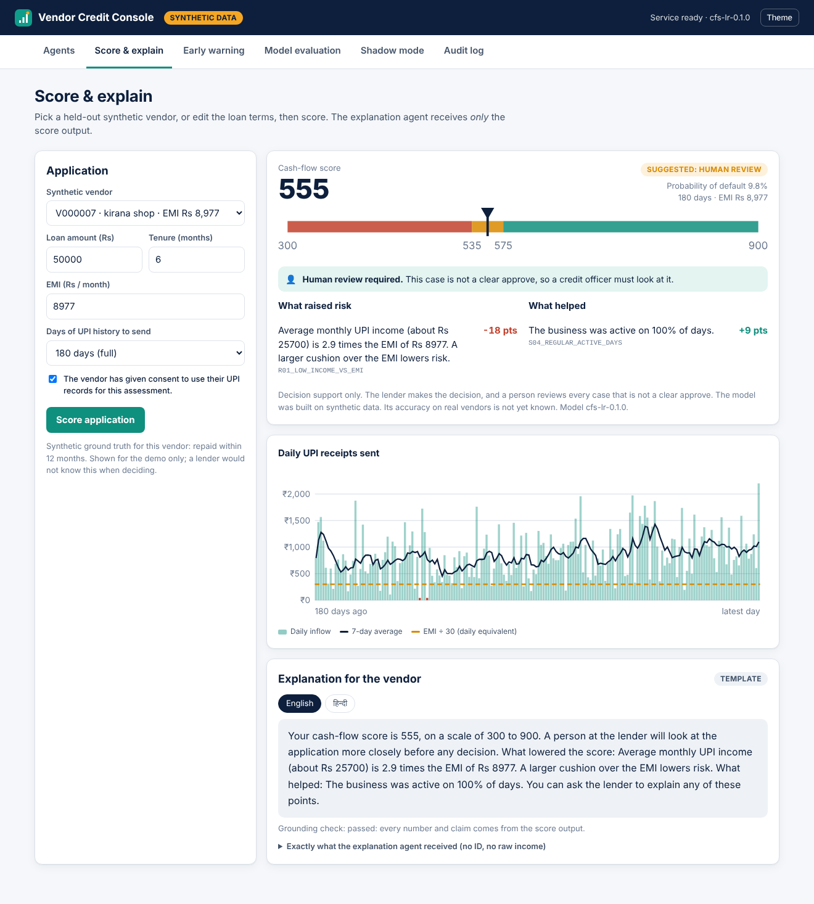
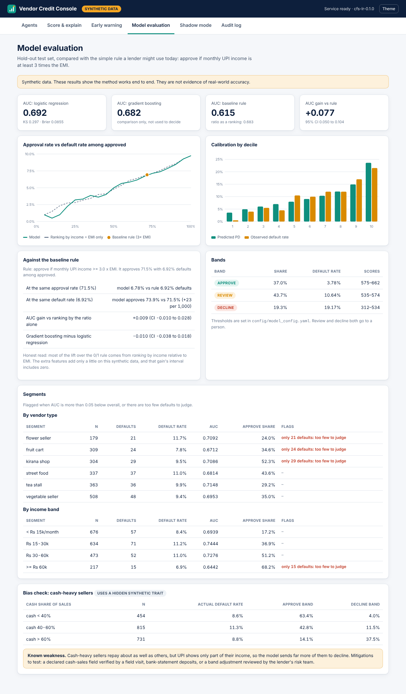
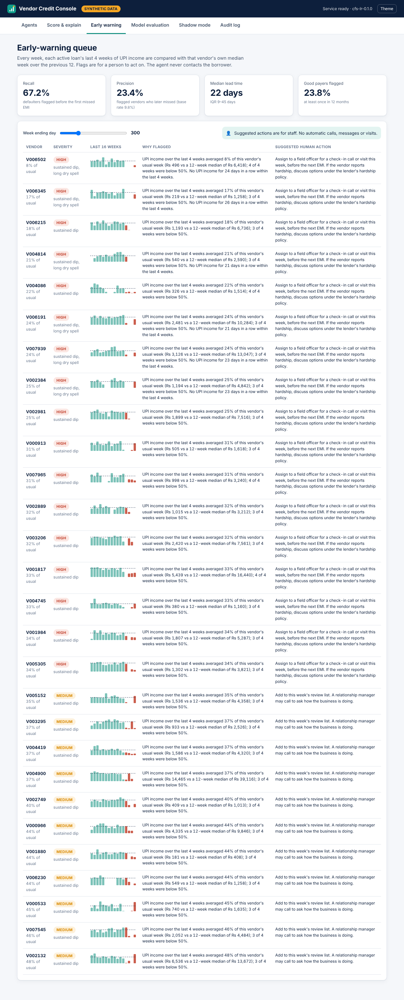
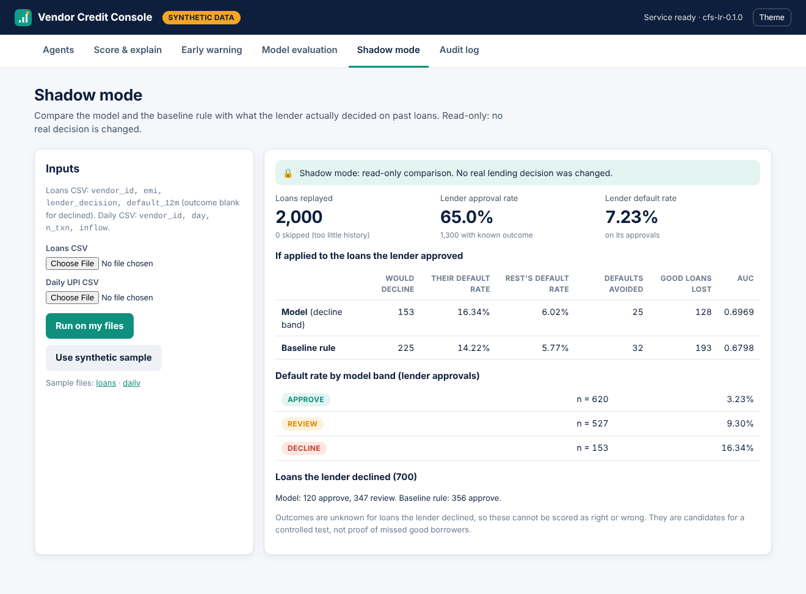

# Vendor cash-flow credit: decision support for NBFCs

A decision-support system that helps Indian NBFCs assess street vendors and small shops that have **no credit bureau history**, using their daily UPI receipts.
The system only supports decisions. **The lender decides, and a person reviews every case that is not a clear approve.**

> **All data in this build is synthetic.** None of the numbers below are real-world accuracy. The next step is a shadow-mode test on a lender's anonymised past loans.

This build follows the plan in the *NBFC research readout*: a cash-flow score tested in shadow mode first, an early-warning agent, explainable reasons, and humans in charge of hard cases.

---

## The agents

| Agent | What it does | Input | Output | Guardrails |
|---|---|---|---|---|
| **1. Scoring agent** (`vendorscore.model`, `POST /score`) | Turns 90 to 180 days of UPI receipts into a probability of default, a 300-900 score, a suggested band and reason codes | consent flag, loan terms, daily `{day, n_txn, inflow}` | PD, score, band (approve / review / decline), top 3 risk reasons, top 2 strengths, in English and Hindi | Logistic regression with public coefficients; every coefficient sign is tested; rejects requests without consent (403) or with fewer than 90 days (422) |
| **2. Explanation agent** (`vendorscore.agents.explainer`, `POST /explain`) | Writes a short, kind explanation for the vendor in English and Hindi | **only** the `/score` output, whitelisted down to the score, band and reason texts | `{en, hi}`, plus which source was used (LLM or template) and the validator's result | No personal data sent to the LLM; validator rejects any number not in the input, approval promises, advice on gaming the score, and outside facts (bureau, collateral, rates); falls back to a deterministic template |
| **3. Early-warning agent** (`vendorscore.agents.early_warning`, `GET /ews/queue`) | Weekly job: compares each active loan's last 4 weeks with the vendor's own median week over the previous 12 weeks | weekly UPI totals | severity, reason, **suggested action for a person** | `auto_contact` is always `False`; never contacts the borrower |
| **4. Shadow-mode agent** (`vendorscore.agents.shadow`, `POST /shadow/report`) | Replays past loans and compares the model and the baseline rule with the lender's actual decisions | CSV of past loans (decision and outcome) plus UPI records | agreement tables, default rate by band, swap-out analysis | Read-only; uses outcomes only for approved loans (reject-inference caveat stated); always reports the baseline rule |

The **lender console** at `http://localhost:8000/` has one page per agent, plus the evaluation report and the audit log.

## Quick start

```bash
cd nbfc-cashflow-credit
python3.11 -m venv .venv && . .venv/bin/activate
make install          # pip install -r requirements-dev.txt
make all              # Phase 1 data -> Phase 2 model -> Phase 3/6/7 reports (about 30 s)
make test             # 63 pytest tests
AUDIT_SALT=change-me make serve      # API + console on http://localhost:8000
```

Docker:

```bash
docker build -t vendorscore .
docker run -p 8000:8000 -e AUDIT_SALT=change-me vendorscore
# optional: -e ANTHROPIC_API_KEY=...   (otherwise explanations use the template)
```

Score a vendor from the command line:

```bash
curl -s localhost:8000/demo/vendor/V000007 | python -c "import json,sys;print(json.dumps(json.load(sys.stdin)['payload']))" > /tmp/req.json
curl -s -X POST localhost:8000/score -H 'content-type: application/json' -d @/tmp/req.json | python -m json.tool
```

## API

| Method | Path | Purpose |
|---|---|---|
| POST | `/score` | Score one application (`vendor_id`, `consent_given`, `loan{amount, tenure_months, emi or annual_rate}`, `daily_records[]`) |
| POST | `/explain` | Explanation agent; body is the `/score` response |
| GET | `/health`, `/model-info` | Liveness; model version, coefficients, bands and thresholds |
| GET | `/ews/queue?as_of_day=300` | Early-warning queue for synthetic held-out loans |
| POST | `/shadow/report` | Shadow mode on `{loans_csv, daily_csv}` text |
| GET | `/reports/{evaluation,early_warning,shadow_report}` | Generated reports |
| GET | `/audit/tail` | Last audit entries, with hash-chain verification |
| GET | `/demo/*`, `/shadow/sample.csv` | Synthetic demo data (turn off with `DEMO_MODE=0`) |

## Configuration

Every threshold lives in [`config/model_config.yaml`](config/model_config.yaml): band cut-offs, score scaling (+40 points doubles the good-to-bad odds), the baseline rule, early-warning thresholds, the LLM model, and the seed.

LLM settings: `LLM_PROVIDER=auto|anthropic|none` and `LLM_MODEL` (default `claude-opus-5-5`, with server-side fallback enabled if the model declines). Any provider that implements `generate(system, user) -> str` can be plugged in through `vendorscore.agents.llm`.

**Free option: a local model with [Ollama](https://ollama.com).** No key and no cost, and nothing leaves your machine:

```bash
ollama pull qwen2.5:7b          # or another model that handles Hindi well
LLM_PROVIDER=openai_compatible LLM_MODEL=qwen2.5:7b make serve
```

`LLM_PROVIDER=openai_compatible` also works with any hosted OpenAI-style endpoint: set `LLM_BASE_URL` and `LLM_API_KEY`.

## Privacy and audit

* Consent is checked before anything is scored.
* The audit log (`artifacts/audit_log.jsonl`) is append-only and hash-chained. It stores the HMAC of the vendor ID (set `AUDIT_SALT`), loan terms, the number and span of days, and the result. **Raw daily income is never stored.**
* The LLM receives only the score, band and reason sentences: no ID, no amounts beyond those already in the reasons, no raw series.

## Layout

```
config/model_config.yaml     all thresholds
src/vendorscore/data/synth.py      Phase 1 synthetic generator
src/vendorscore/features.py        Phase 2 features
src/vendorscore/model.py           Phase 2 scorecard, bands, reason codes
src/vendorscore/evaluate.py        Phase 3 evaluation
src/vendorscore/api/               Phase 4 FastAPI app, schemas, audit log
src/vendorscore/agents/explainer.py, llm.py   Phase 5
src/vendorscore/agents/early_warning.py       Phase 6
src/vendorscore/agents/shadow.py              Phase 7
ui/index.html                lender console
docs/DATA_SCHEMA.md          contract for replacing synthetic data with lender data
docs/PHASE_REPORTS.md        per-phase results, limitations, open questions
reports/                     generated evaluation, early-warning and shadow reports
```

## Screenshots





